# Lab Métriques : Prometheus, Grafana et Datadog

# Objectifs 

Dans ce lab nous voyons 2 approches de la récupération des métriques :

- mode **Pull** : un serveur central récupère les métriques, c'est le cas de Prometheus
- mode **Push** : sur chaque équipement, un agent exporte les métriques vers un serveur central, c'est le cas de Datadog

# Contenu

- [NodeExporter/Prometheus/Grafana](#nodeexporterprometheusgrafana)
    - [Installation d'un serveur Prometheus](#installation-dun-serveur-prometheus)
    - [Installation de NodeExporter sur un autre serveur](#installation-de-nodeexporter-sur-un-autre-serveur-clt)
    - [Ajout de la supervision du serveur Linux depuis srv](#ajout-de-la-supervision-du-serveur-linux-clt-depuis-srv)
    - [Ajout du service Grafana](#ajout-du-service-grafana)
    - [Dashboard Grafana](#dashboard-grafana)
    - [Ajout d'une métrique custom dans NodeExporter](#ajout-dune-métrique-custom-dans-nodeexporter)
    - [Instrumenter le code pour Prometheus](#instrumenter-le-code-pour-prometheus)

- [Datadog](#supervision-avec-datadog)
    - [Installation de l'agent Datadog](#installation-de-lagent-datadog)
    - [Récupération d'une métrique custom](#métrique-custom-dans-datadog)


# Les serveurs dédiés à la disposition de chaque participant.e

On utilise 2 VMs :
- le serveur de supervision (`srv` ) sur lequel on va installer `Prometheus` et `Grafana`
- la machine supervisée (`clt`) sur lequel on va installer `NodeExporter`

**Note** : L'animateur vous a fourni les noms DNS (FQDN) des serveurs `srv` et `clt`, il suffira de les utiliser à chaque fois que vous voyez dans les labs `srv_FQDN` et `clt_FQDN`

# NodeExporter/Prometheus/Grafana

Prometheus "scrape" (c-a-d lit et analyse) les métriques sur les serveurs supervisés, les stocke dans sa TSDB, accessible pour Grafana.

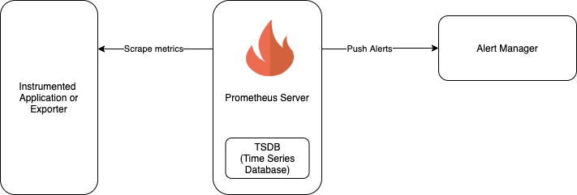

## Installation d'un serveur `Prometheus`

Connectez-vous au serveur de supervision `srv` suivant les accès fournis par l'animateur.

Vérifions que le moteur `docker` et `docker compose` sont bien installés
```
docker version
docker compose version
```

Créons le répertoire `/home/prometheus` :
```
mkdir /home/prometheus
cd /home/prometheus
```

Créons dans ce répertoire le fichier ```docker-compose.yml``` ci-dessous qui définit le service `prometheus` en copiant-collant directement cette commande dans le shell :

```
cat <<EOF >docker-compose.yml
services:
  prometheus:
    image: prom/prometheus
    container_name: prometheus
    restart: unless-stopped
    ports:
      - "9090:9090"
    volumes:
      - ./prometheus.yml:/etc/prometheus/prometheus.yml
      - prometheus-data:/prometheus
    command:
      - "--config.file=/etc/prometheus/prometheus.yml"

volumes:
  prometheus-data:
EOF
```

Créons le fichier de configuration  ```/home/prometheus/prometheus.yml``` en tapant cette ligne de commande  :

```
cat <<EOF >/home/prometheus/prometheus.yml
global:
  scrape_interval: 10s

scrape_configs:
  - job_name: 'prometheus'
    static_configs:
      - targets: ['prometheus:9090']

EOF
```

Notez l'utilisation du nom `prometheus` qui sera résolu localement par Docker.

Lançons le serveur :
```bash
docker compose up -d --force-recreate
```

Naviguez sur la page Prometheus : `http://srv_FQDN:9090` , et explorez les métriques.

Par exemple, retrouvez la métrique qui donne le timestamp de lancement du service prometheus et affichez sa valeur et son graphe.

Autre exemple (cf [doc](https://prometheus.io/docs/prometheus/latest/querying/examples/)), agrégez les visites des pages web par URI :
```
sum(prometheus_http_requests_total) by (handler)
```
ou par code retour :
```
sum(prometheus_http_requests_total) by (code)
```
ou lister les 3 URLs qui comptabilisent le plus de code 200
``` 
topk(3,prometheus_http_requests_total{code="200"})
```

## Installation de `NodeExporter` sur un autre serveur (`clt`)

Sur l'autre VM (appellons-la `clt`), installons `NodeExporter` :

Le mieux est de suivre cette [procédure](https://gist.github.com/nwesterhausen/d06a772cbf2a741332e37b5b19edb192) , que nous reproduisons ci-dessous :

```bash
VERSION=1.8.2
useradd --no-create-home --shell /bin/false node_exporter
wget https://github.com/prometheus/node_exporter/releases/download/v${VERSION}/node_exporter-${VERSION}.linux-amd64.tar.gz
tar xvf node_exporter-${VERSION}.linux-amd64.tar.gz
mv node_exporter-${VERSION}.linux-amd64 /opt/node_exporter
chown -R node_exporter:node_exporter /opt/node_exporter
```

Créer le fichier ```/etc/systemd/system/node_exporter.service``` :

```
cat <<EOF >/etc/systemd/system/node_exporter.service
[Unit]
Description=Node Exporter
Wants=network-online.target
After=network-online.target

[Service]
User=node_exporter
Group=node_exporter
Type=simple
ExecStart=/opt/node_exporter/node_exporter --collector.systemd

[Install]
WantedBy=multi-user.target

EOF
```

Puis mettons en place le service

```bash
systemctl daemon-reload
systemctl enable --now node_exporter
systemctl status node_exporter --no-pager
```

**NB** : la version recommandée de NodeExporter pour ce lab est la 1.8.2, modifiez la variable `VERSION` pour en utiliser une autre.

Naviguez sur la page NodeExporter : `http://clt_FQDN:9100/metrics`


## Ajout de la supervision du serveur Linux `clt` depuis `srv`

**Sur le serveur Prometheus, c-a-d `srv`**,

Tout d'abord créez la variable CLT avec la véritable valeur de `clt_FQDN` :

```bash
CLT=clt_FQDN
```

Puis, grâce à la commande suivante, ajoutons (avec interpolation) en fin de fichier ```/home/prometheus/prometheus.yml``` ceci  :

```bash
cat << EOF >> /home/prometheus/prometheus.yml
  - job_name: 'node-exporter'
    static_configs:
      - targets: ['${CLT}:9100']
EOF
```

Relancer le service Prometheus :

```bash
cd /home/prometheus
docker compose restart
```

Naviguez sur la page Prometheus : `http://srv_FQDN:9090/targets` pour visualiser les endpoints "scrapés".

Par ailleurs, requêtez et graphez par exemple la métrique `node_network_receive_bytes_total`

## Ajout du service `Grafana`

Grafana va être exécuté sous la forme d'un container Docker, sur notre serveur `srv`.

Le plus simple et efficace consiste donc à étendre notre ```docker-compose.yml``` initial ainsi (c-a-d en insérant le bloc `grafana` et son `volume`), grâce à la commande ci-dessous :

```bash
cat << EOF > /home/prometheus/docker-compose.yml
services:
  prometheus:
    image: prom/prometheus
    container_name: prometheus
    restart: unless-stopped
    ports:
      - "9090:9090"
    volumes:
      - ./prometheus.yml:/etc/prometheus/prometheus.yml
      - prometheus-data:/prometheus
    command:
      - "--config.file=/etc/prometheus/prometheus.yml"

  grafana:
    image: grafana/grafana-enterprise
    container_name: grafana
    restart: unless-stopped
    ports:
      - "3000:3000"
    volumes:
      - grafana-data:/var/lib/grafana

volumes:
  prometheus-data:
  grafana-data:
EOF
```

Relancons les containers grâce à docker-compose :

```bash
docker compose up -d --force-recreate
```

Consultons l'interface web de Grafana en HTTP sur le port 3000 avec les creds `admin/admin` : `http://srv_FQDN:3000`

- Aller dans le menu sur la gauche et sélectionner “Connections / Data Sources”
- Cliquer sur “Add your data source”
- Choisir “Prometheus” dans la liste
- Renseigner cette URL : http://prometheus:9090 (le nom du container prometheus est résolu en interne par docker)
- Cliquer sur  “Save & Test” pour vérifier la connexion entre Grafana et Prometheus

## Dashboard Grafana

- Chercher **sur le web** dans la page [Grafana Dashboard](https://grafana.com/grafana/dashboards/) le dashboard ”Node Exporter Full”.
- Copier le dashboard ID. Dans notre cas, l'ID est 1860.
- De retour sur *notre* Grafana, sur la gauche, cliquer sur  “Dashboard” puis le bouton bleu en haut à gauche "New" : dans cette liste déroulante, sélectionner “Import”
- Dans la section “Grafana.com Dashboard” , copier le dashboard ID (1860) dans le champ “Grafana.com Dashboard ID” .
- Cliquer sur le bouton “Load” , sélectionner *notre* prometheus dans le champ (liste déroulante)

Naviguer dans la section des Dashboard.... 

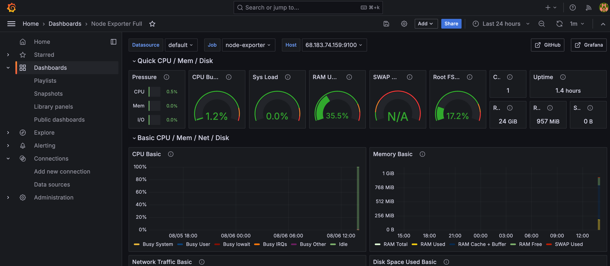

## Ajout d'une métrique custom dans NodeExporter

Sur le serveur supervisé (`clt`) :

```bash
mkdir /home/textfile
```

Configurez le service NodeExporter pour prendre en compte ce répertoire (seule la ligne `ExecStart` de `/etc/systemd/system/node_exporter.service` change, la commande suivante réécrit le fichier en entier) :

```bash
cat <<EOF >/etc/systemd/system/node_exporter.service
[Unit]
Description=Node Exporter
Wants=network-online.target
After=network-online.target

[Service]
User=node_exporter
Group=node_exporter
Type=simple
ExecStart=/opt/node_exporter/node_exporter --collector.systemd --collector.textfile.directory=/home/textfile

[Install]
WantedBy=multi-user.target

EOF
```


Puis relançons NodeExporter :
```bash
systemctl daemon-reload
systemctl restart node_exporter.service  
```

Créons (à la main) un fichier contenant notre métrique custom (dont la valeur vaut le nombre de secondes depuis l'*epoch*):
```
echo ma_metrique_custom $(date +%s) > /home/textfile/ma_metrique_custom.prom
```

Naviguez sur la page NodeExporter : http://clt_FQDN:9100/metrics  et constatez que notre métrique est incluse dans la page !
```
curl -s http://localhost:9100/metrics | grep "ma_metrique_custom"
```

On obtient :
```
# HELP ma_metrique_custom Metric read from /home/textfile/ma_metrique_custom.prom
# TYPE ma_metrique_custom untyped
ma_metrique_custom 1.722946125e+09
node_textfile_mtime_seconds{file="ma_metrique_custom.prom"} 1.722946125e+09
```

Cette métrique doit également être consultable sur Prometheus directement : http://srv_FQDN:9090

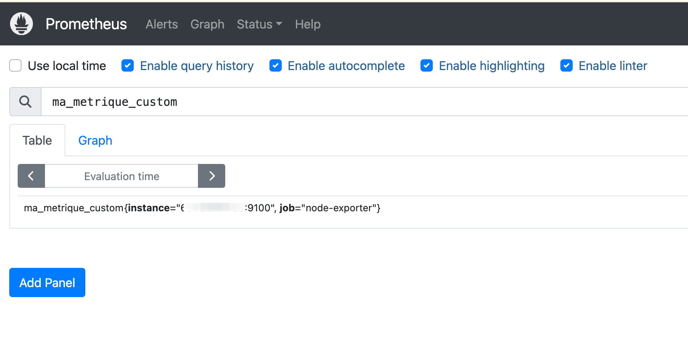

Plus de détails [ici](https://github.com/prometheus-community/node-exporter-textfile-collector-scripts)

Dans un script réel, écrivez le fichier de façon atomique (avec ```sponge``` ou en écrivant dans un fichier temporaire puis en le renommant avec `mv`), afin que NodeExporter ne lise jamais un fichier à moitié écrit.

## Instrumenter le Code pour Prometheus

Sur `clt`, nous allons instrumenter  une application API écrite en python avec flask.

Le code de notre application est le suivant :

```python
from flask import Flask, request, render_template_string
from prometheus_client import start_http_server, Counter, Histogram, generate_latest
from prometheus_client.core import CollectorRegistry
import time
import random

# Initialiser l'application Flask
app = Flask(__name__)

# Crée un compteur pour les appels de fonction
REQUEST_COUNT = Counter('my_function_request_count', 'Total number of requests to my_function')

# Crée un histogramme pour les temps d'exécution
REQUEST_LATENCY = Histogram('my_function_request_latency_seconds', 'Latency of requests to my_function in seconds')

# Décorateur pour mesurer les métriques
def metric_decorator(func):
    def wrapper(*args, **kwargs):
        REQUEST_COUNT.inc()  # Incrémente le compteur de requêtes
        with REQUEST_LATENCY.time():  # Mesure le temps d'exécution de la fonction
            result = func(*args, **kwargs)
        return result
    return wrapper

@metric_decorator
def my_function():
    # Simule une tâche longue avec un temps d'exécution aléatoire
    time.sleep(random.uniform(0.1, 0.5))
    return "Function is complete."

@app.route('/')
def index():
    # Appel de la fonction décorée
    message = my_function()
    return render_template_string("<h1>{{ message }}</h1>", message=message)

@app.route('/metrics')
def metrics():
    # Exposer les métriques au format texte brut pour Prometheus
    return generate_latest()

if __name__ == '__main__':
    # Démarre un serveur HTTP pour exposer les métriques sur le port 8000
    start_http_server(8000)
    
    # Démarre l'application Flask sur toutes les interfaces réseau (0.0.0.0) sur le port 5000
    app.run(host='0.0.0.0', port=5000)
```

Vérifions que les modules Python nécessaires sont présents (sinon, sur Debian/Ubuntu : `apt install python3-flask python3-prometheus-client`) :
```bash
python3 -c "import flask, prometheus_client"
```

Importons ce script puis lançons-le :
```bash
wget "https://raw.githubusercontent.com/pragmatic-fermat/observabilite_des_applications/refs/heads/main/data/myapp.py" -O /home/myapp.py
python3 /home/myapp.py
```


Visiter le site web  http://clt_FQDN:5000 (l'application)

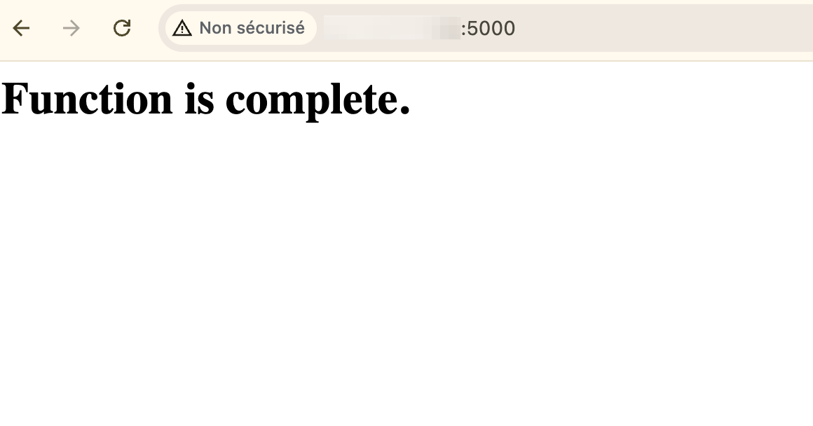

puis le site http://clt_FQDN:8000  (les métriques Prometheus) 

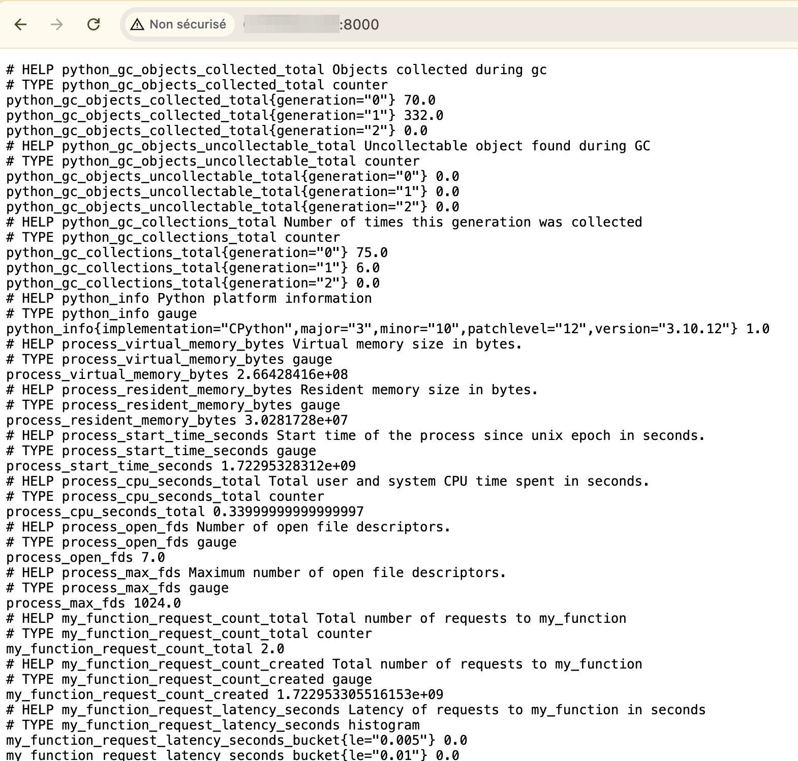

## Cleanup

Arrêter le programme python (Ctrl-C) puis, sur `srv`, le reste des containers (i.e Prometheus et Grafana) ainsi :

```bash
cd /home/prometheus
docker compose down
```

Ajoutez l'option `-v` pour supprimer également les volumes (données Prometheus et Grafana).

# Supervision avec Datadog

## Installation de l'agent Datadog

Créez un compte (gratuit) sur [Datadog](http://datadog.com)

Suivre la procédure d'[installation d'un agent systeme](https://app.datadoghq.eu/account/settings/agent/latest?platform=overview) (Integration > Agent) avec la création à la volée d'une clé API.

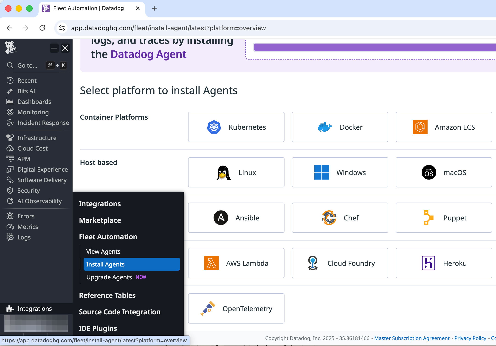

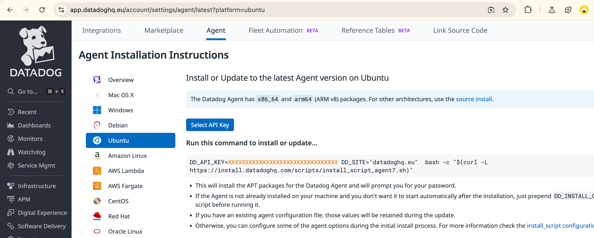

Copiez et exécutez cette commande sur `clt`


Au bout de quelques minutes, votre serveur `clt` va apparaître dans le portail Datadog, menu à gauche "Infrastructure > Hosts"

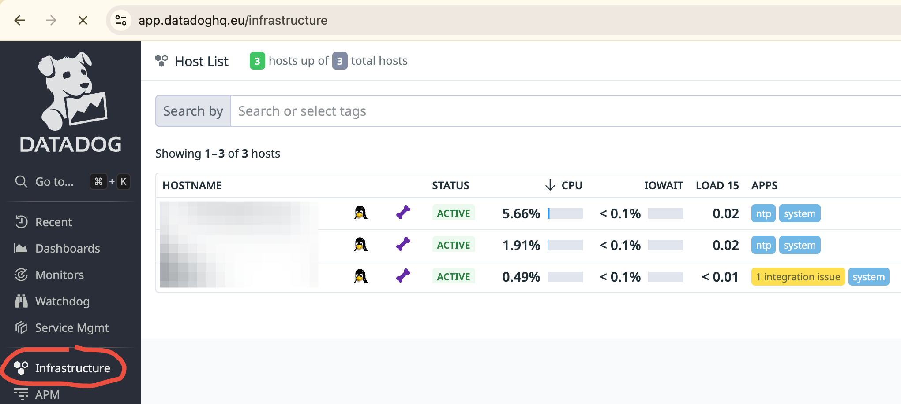

Vous pouvez créer une alerte (monitor) sur cette [page](https://app.datadoghq.eu/monitors/create) en choisissant par exemple la métrique ```system.disk.free``` ou autre...)

## Métrique custom dans Datadog

Supposons que nous souhaitions connaître le nombre de lignes dans les tables d'une base de données.

### Installation d'une base de données sur le serveur supervisé

Sur notre serveur `clt`, connectons nous à la base de données mariadb (pré-installée, mot de passe vide) :

```bash
mysql -u root -e "SELECT VERSION();"
```

Importons le fichier de base de données qui se trouve (déja) dans /home/mysqlsampledatabase.sql :
```
mysql -u root -e "source /home/mysqlsampledatabase.sql;"
mysql -u root -e "show databases;"
```
donne :
```
+--------------------+
| Database           |
+--------------------+
| classicmodels      |
| information_schema |
| mysql              |
| performance_schema |
| sys                |
+--------------------+
```
Puis configurons le mot de passe root mysql
```
mysql -u root -e "ALTER USER 'root'@'localhost' IDENTIFIED BY 'MyN3wP4ssw0rd';"
mysql -u root -pMyN3wP4ssw0rd -e "flush privileges;"
```

**Note** : ce mot de passe est celui du lab, il figure aussi en clair dans la configuration de l'agent ci-dessous. Ne le réutilisez jamais en dehors de ce contexte.

### Configuration de l'agent Datadog

Sur le serveur supervisé (i.e `clt`):

```
cd /etc/datadog-agent/conf.d/mysql.d
```

Dans le fichier `conf.yaml` nous voudrions injecter (en faisant attention aux indentations) quelque chose comme ceci:

```yaml
init_config:
instances:
  - host: localhost
    dbm: true
    username: root
    password: MyN3wP4ssw0rd
    port: 3306

    custom_queries:
      - query: SELECT COUNT(*) FROM classicmodels.customers
        columns:
         - name: classicmodels.customers
           type: gauge
      - query: SELECT COUNT(*) FROM classicmodels.employees
        columns:
         - name: classicmodels.employees
           type: gauge
      - query: SELECT TABLE_NAME, TABLE_ROWS FROM information_schema.TABLES WHERE TABLE_SCHEMA = 'classicmodels'
        columns:
         - name: classicmodels.table_name
           type: tag
         - name: classicmodels.table_rows
           type: gauge
```

Si vous souhaitez éviter l'édition du fichier, cette commande fera alors le travail :

```bash
rm -f conf.yaml.example
wget "https://raw.githubusercontent.com/pragmatic-fermat/observabilite_des_applications/refs/heads/main/config/datadog/conf.yaml" -O conf.yaml
```


Relancer l'agent datadog et vérifier que le plugin SQL est sans erreur :

```bash
systemctl restart datadog-agent
```
Lancer plusieurs fois l'outil de diagnostic jusqu'à ce que le paragraphe MySQL soit ok :

```
datadog-agent status | grep -A10 -i mysql 
```

qui donne
```
    mysql (12.5.1)
    --------------
      Instance ID: mysql:4bf5f516622ead61 [OK]
      Configuration Source: file:/etc/datadog-agent/conf.d/mysql.d/conf.yaml
      Total Runs: 1
      Metric Samples: Last Run: 69, Total: 69
      Events: Last Run: 0, Total: 0
      Database Monitoring Metadata Samples: Last Run: 1, Total: 1
      Service Checks: Last Run: 1, Total: 1
      Average Execution Time : 533ms
      Last Execution Date : 2024-08-07 06:09:51 UTC (1723010991000)
      Last Successful Execution Date : 2024-08-07 06:09:51 UTC (1723010991000)

```

Ensuite aller dans Datadog :
- activer l'intégration MySQL

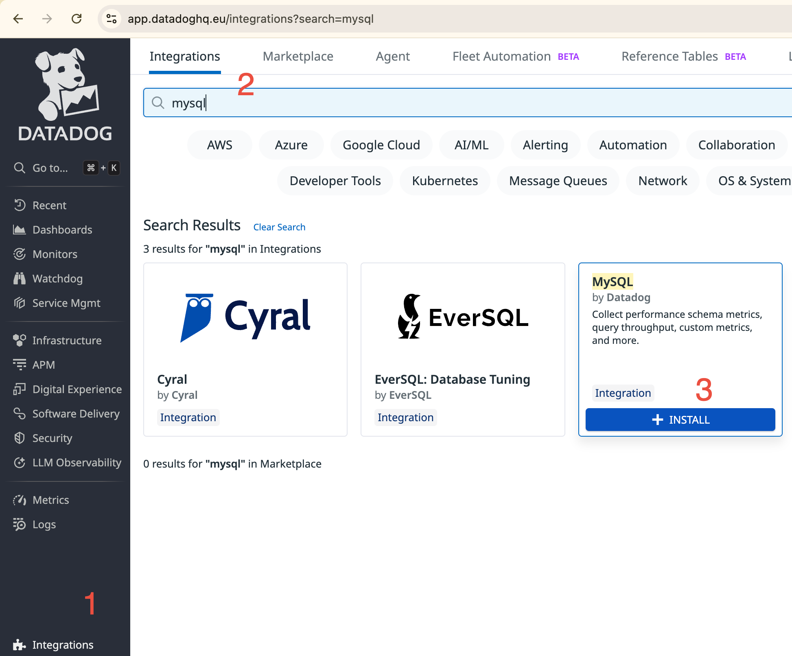

- explorer les métriques (menu "Metric Explorer" à gauche)

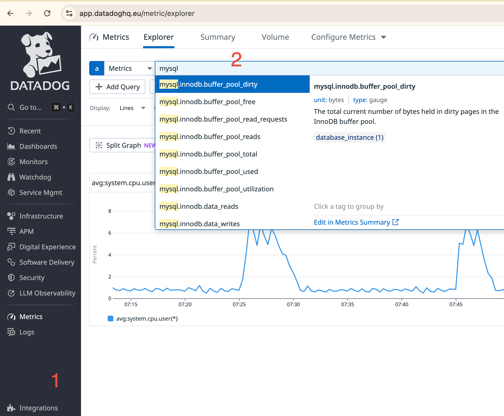

- retrouver nos 2 métriques custom :

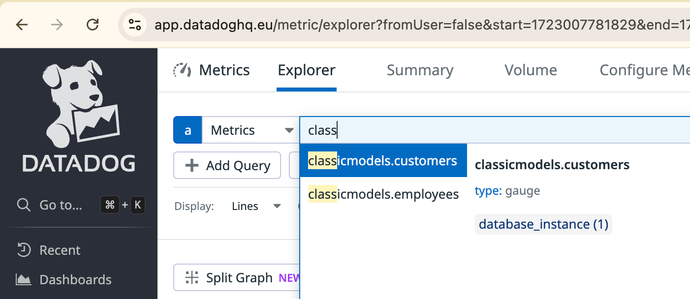

- dans un Dashboard, ajouter 2 graphes montrant le nombre de customers et d'employes

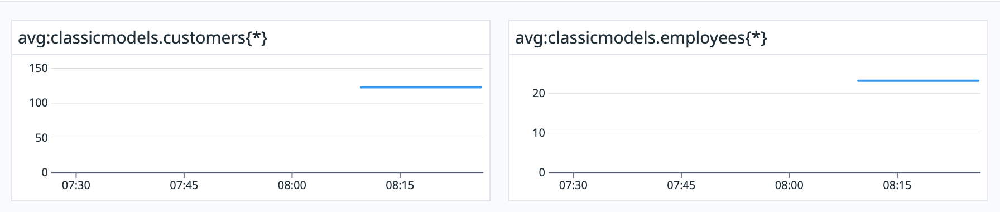

- puis construisez une TopList qui montre le nombre de lignes par table dans notre database 'classicmodels' :

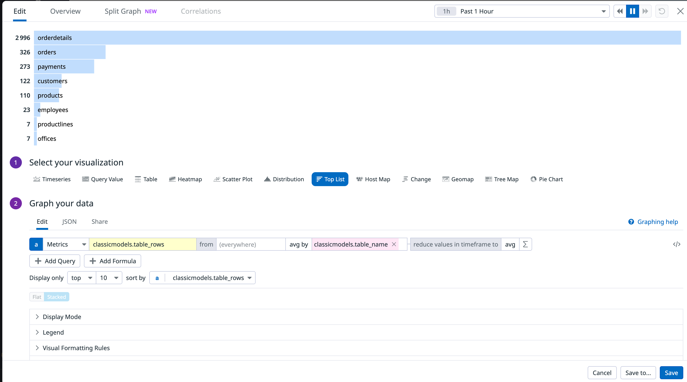

Faire attention à bien selectionner "classicmodels.table_name" dans le champ "avg by"

Soit

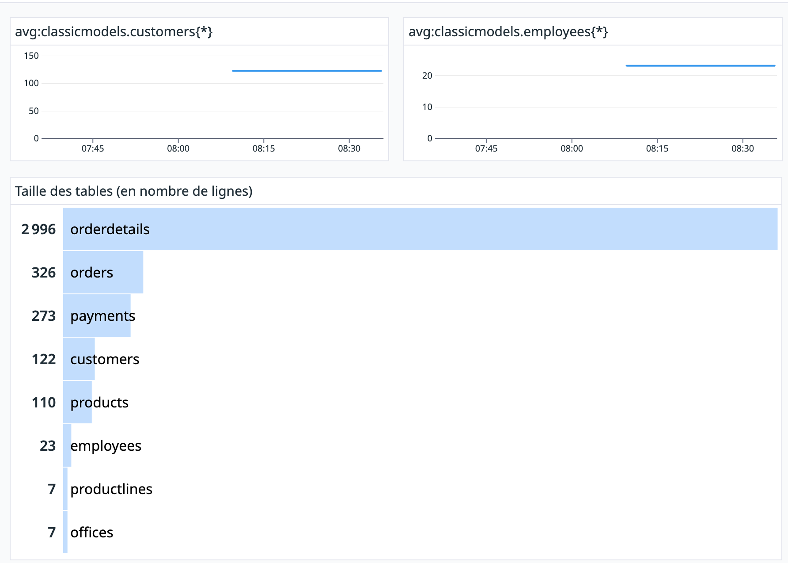

## Cleanup

Sur `clt`, arrêtons l'agent :

```bash
systemctl disable --now datadog-agent
```

Dans Datadog, révoquez la clé API créée pour ce lab (Organization Settings > API Keys).
