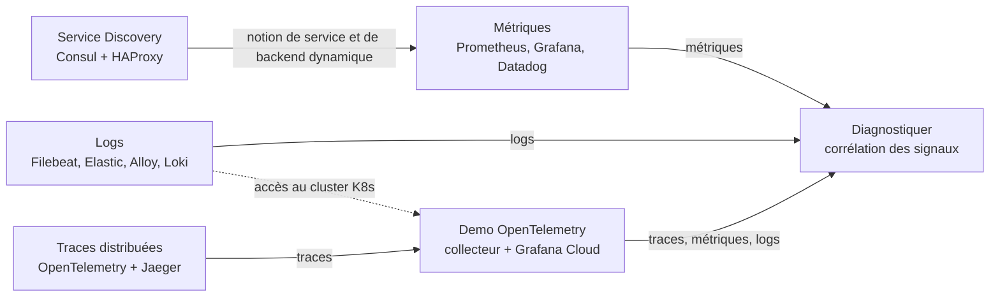

# Liste des Labs

- [Service Discovery](/Lab_ServiceDiscovery.md)
- [Métriques](/Lab_Metriques.md)
- [Logs](/Lab_Logs.md)
- [Instrumentation et Traces distribuées](/Lab_Traces_Distribuees.md)
- [Demo OpenTelemetry](/Lab_OpenTelemetry_Demo.md)
- [Diagnostiquer](/Lab_Diag.md)

**[Option]**: [Setup Github CodeSpace](/Setup_Github_CodeSpace.md)

## Comment lire les schémas

Les labs contiennent des schémas [Mermaid](https://mermaid.js.org/), affichés directement dans le rendu Markdown de GitHub. VS Code et Codespaces récents les affichent aussi dans l'aperçu Markdown grâce à l'extension intégrée « Mermaid Markdown Features » (VS Code 1.121 et suivants) ; sur une version plus ancienne, une extension de prévisualisation Mermaid reste nécessaire. Je les ai placés au début des parties conceptuelles, avant les commandes, pour que le rôle de chaque composant soit lisible d'abord.

Conventions communes :

- trait plein : flux principal du schéma (requête applicative, donnée collectée, enchaînement entre labs) ;
- trait pointillé : flux secondaire ou indirect (enregistrement d'un service, spans OTLP, prérequis, lien volontairement absent du lab) ;
- encadré : périmètre d'exécution (VM `srv`, VM `clt`, cluster Kubernetes, cloud).

Dans les diagrammes de séquence, les flèches en pointillés sont les réponses, conformément à la syntaxe Mermaid.

Chaque schéma est partiel : je précise juste en dessous ce qu'il montre et ce que je laisse de côté. Les commandes, les ports de détail, les écrans et les règles de firewall restent dans le texte du lab.

## Carte des labs

Ce schéma ne montre que l'enchaînement logique des labs et le signal principal apporté par chacun. Je ne représente pas l'ordre exact des manipulations, les VM, ni les prérequis partagés : le [Lab Logs](/Lab_Logs.md) fournit par exemple l'accès au cluster Kubernetes réutilisé par le [Lab Demo OpenTelemetry](/Lab_OpenTelemetry_Demo.md).
